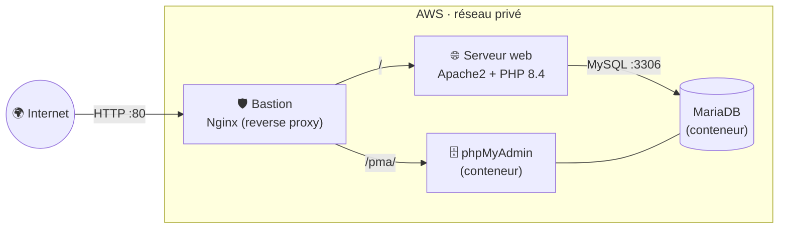

<h1 align="center">🛡️ Ansible2I</h1>

<p align="center">
  <strong>Déploiement automatisé d'une architecture web 3-tiers sur AWS avec Ansible :<br/>
  un bastion Nginx, un serveur Apache/PHP et une base MariaDB, configurés en une seule commande.</strong>
</p>

<p align="center">
  
  
  
  
  
  
  
  
</p>

---

Trois machines Debian vierges sur AWS. Un `./deploy.sh` plus tard, on obtient un site PHP relié à sa base de
données, derrière un reverse proxy qui est le **seul point d'entrée** depuis Internet.

## 🏗️ Architecture



| Machine | Rôle Ansible | Ce qui est installé |
|---|---|---|
| 🛡️ Bastion | `bastion` | Nginx, qui redirige `/` vers le serveur web et `/pma/` vers phpMyAdmin |
| 🌐 Serveur web | `webserver` | Apache2, PHP 8.4, page d'accueil, `info.php` et `dump.table.php` (test de lecture en base) |
| 🗄️ Base de données | `database` | Docker, conteneurs MariaDB et phpMyAdmin sur un réseau dédié, import du jeu SQL |

## ✨ Ce que le projet montre

- **🧩 Rôles Ansible réutilisables**, chacun avec ses tâches, variables, templates Jinja2 et handlers.
- **⚙️ Configuration paramétrée** : IP, version de PHP et utilisateurs passent par des variables, pas en dur dans les tâches.
- **🛡️ Une seule porte d'entrée** : seul le bastion est exposé, les autres machines restent sur le réseau privé.
- **🔐 Secrets chiffrés** avec Ansible Vault, partagés entre le serveur web et la base sans jamais apparaître en clair.
- **🧪 Vérification automatique** : `test.sh` contrôle la clé SSH, la connectivité Ansible et la réponse des services.
- **♻️ Remise à zéro** : `clean_and_redeploy.sh` nettoie puis redéploie tout.

## 🚀 Démarrage rapide

### Prérequis

- **3 instances EC2** Debian 12 (t3.micro suffit), dans un même groupe de sécurité
- La **clé SSH** des instances dans `~/.ssh/vockey.pem` (`chmod 600`)
- **Ansible** sur votre machine, avec la collection Docker : `ansible-galaxy collection install community.docker`
- Les adresses IP des instances renseignées dans [`inventory`](inventory), et l'IP privée de la base dans
  `roles/webserver/vars/main.yml` et `roles/bastion/vars/main.yml`

### Déploiement

```bash
git clone https://github.com/DHoudetot-Cyril/Ansible2I.git
cd Ansible2I
chmod +x deploy.sh test.sh clean_and_redeploy.sh

# Secrets : on part du modèle, on choisit les mots de passe, puis on chiffre
cp group_vars/all/vault.yml.example group_vars/all/vault.yml
nano group_vars/all/vault.yml
ansible-vault encrypt group_vars/all/vault.yml

./deploy.sh      # vérifie clé SSH, connectivité et chiffrement, puis lance deploy-site.yml
./test.sh        # vérifie que tout répond
```

| Service | URL |
|---|---|
| Site web | `http://<IP_BASTION>/` |
| Test web ↔ base | `http://<IP_BASTION>/dump.table.php` |
| Configuration PHP | `http://<IP_BASTION>/info.php` |
| phpMyAdmin | `http://<IP_BASTION>/pma/` |

> 🔐 Aucun mot de passe n'est écrit dans le dépôt. Ils sont dans `group_vars/all/vault.yml`, **chiffré avec
> Ansible Vault** et ignoré par Git. `deploy.sh` refuse de se lancer si ce fichier manque ou n'est pas chiffré.
> Le mot de passe du vault est demandé au clavier, ou lu dans `.vault_pass` (également ignoré par Git).

## 📁 Structure du projet

```text
Ansible2I/
├── inventory               # les 3 machines et leurs IP
├── group_vars/all/
│   ├── vars.yml            # variables partagées (base, utilisateur)
│   └── vault.yml.example   # modèle des secrets (le vrai vault.yml est chiffré et ignoré)
├── deploy-site.yml         # playbook principal
├── deploy.sh               # vérifications + lancement du playbook
├── test.sh                 # tests du déploiement
├── clean_and_redeploy.sh   # remise à zéro
└── roles/
    ├── bastion/            # Nginx (reverse proxy)
    ├── webserver/          # Apache + PHP
    ├── database/           # Docker + MariaDB + phpMyAdmin
    └── common/             # variables communes
```

## 🩹 Dépannage

| Problème | Piste |
|---|---|
| Erreur SSH | droits `600` sur la clé, et bon chemin dans `inventory` |
| `vault.yml introuvable` ou non chiffré | suivre les 3 commandes « Secrets » ci-dessus |
| Le site n'atteint pas la base | vérifier l'IP privée de la base dans les `vars` du webserver et du bastion |
| Un service ne répond pas | `ssh` sur la machine puis `systemctl status nginx` (ou `apache2`, `docker`) |

## 🗺️ Pistes d'amélioration

- [ ] Créer les 3 instances avec **Terraform** au lieu de la console AWS
- [ ] HTTPS sur le bastion (Let's Encrypt)
- [ ] Lancer les tests des rôles avec **Molecule** dans une CI

## 👤 Auteur

**Cyril D'Houdetot** · [GitHub](https://github.com/DHoudetot-Cyril)

<sub>Projet réalisé pendant mes études d'ingénieur à l'IG2I, sur un environnement AWS de TP.</sub>
